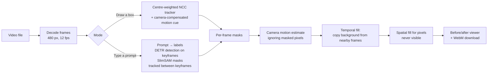

# AI Video Eraser

**Remove a person, car or anything else from a short video, right in your browser.** Draw a box around it or type what it is. The eraser follows it through every frame and fills the gap with the real background from nearby frames. Nothing is uploaded: the video never leaves your device.

**▶ Live demo:** https://sudhaseeli.github.io/ai-video-eraser/

| | |
|---|---|
| **Two modes** | **Draw a box** (instant, works offline) or **describe it** (AI: DETR finds it, SAM cuts the mask) |
| **Camera-aware** | Estimates the camera's motion so panning shots don't smear |
| **Real pixels first** | Hidden background is copied from frames where it's visible; only never-seen pixels are reconstructed |
| **Measured** | On a test clip with a known clean background, quality in the erased area goes from **12.7 dB → 36.3 dB PSNR** |
| **No install** | Plain ES modules; no build step, no server, no upload |

## How it works



1. **Find the object.**
   - *Box mode:* a normalised cross-correlation tracker follows the box. It weights the centre of the box (where the object is), predicts motion from velocity, anchors its template to the first frame so it can't drift onto the background, and adds a camera-compensated motion cue that keeps it on moving objects.
   - *AI mode:* the prompt is mapped to detector labels ("a woman and her dog" → `person`, `dog`). [DETR](https://huggingface.co/Xenova/detr-resnet-50) finds them on keyframes; [SlimSAM](https://huggingface.co/Xenova/slimsam-77-uniform) turns each detection into a pixel mask, prompted with three points down the object so it captures the whole thing. Masks are carried between keyframes by the tracker.
2. **Follow the camera.** Global motion is estimated coarse-to-fine between consecutive frames, ignoring the pixels being erased.
3. **Fill from real footage.** For each erased pixel, the nearest frames (±24) are searched for a camera-aligned view of that spot where it isn't covered. Anything never visible is filled ring by ring from its surroundings.

## Results

The sample clip is synthetic on purpose: a person walks across a textured landscape while the camera pans. Because the clean background is rendered too, the eraser's output can be scored exactly.

| Clip | Frames | Before (PSNR in erased area) | After | Filled from real footage | Time (laptop, Chrome) |
|---|---|---|---|---|---|
| Sample, 384×216, panning | 48 | 12.7 dB | **36.3–38.0 dB** | 100% | ~2–4 s |

AI mode was checked on a real photo of a person: DETR found the person at 1.00 confidence, and SAM's chosen mask covered the full figure. On a CPU, detection takes about 10 s per keyframe at 384 px, so AI mode suits short clips.

## Try it locally

No install, no build. Any static file server works; ES modules just need `http://` rather than `file://`.

```bash
git clone https://github.com/sudhaseeli/ai-video-eraser && cd ai-video-eraser
python scripts/serve.py          # or: npx serve .
# open http://localhost:8765
```

## Tests

Core modules (tracking, masks, motion, filling, metrics, prompt matching) are pure JavaScript and run in both Node and the browser.

```bash
node tests/run.mjs               # Node 18+
# or open http://localhost:8765/tests/ in a browser
```

The tests include end-to-end checks on the sample clip: the tracker must cover ≥85% of the person in every frame, and the erased result must score > 28 dB PSNR against the true background.

## Project layout

```text
index.html            app shell
src/app.js            UI: video input, box drawing, before/after viewer, download
src/video.js          decode frames from a file, encode WebM (browser only)
src/ai.js             DETR + SlimSAM through Transformers.js (loaded from a CDN)
src/ai-select.js      prompt → labels, confidence filter, non-maximum suppression
src/core/             pure JS: tracker, masks, camera motion, temporal/spatial fill, PSNR, sample clip
tests/                harness that runs in Node and the browser
```

## Limits

- Short clips: up to 8 s, resized to 480 px wide, to fit in browser memory.
- Works best when the object moves and the background is visible at some point. A person standing still for the whole clip leaves nothing to copy from, so that area is reconstructed rather than restored.
- AI mode recognises the 80 everyday COCO object types and downloads about 50 MB of models on first use (cached afterwards).
- Output is WebM (VP9/VP8), recorded in real time with MediaRecorder.

## License

MIT
